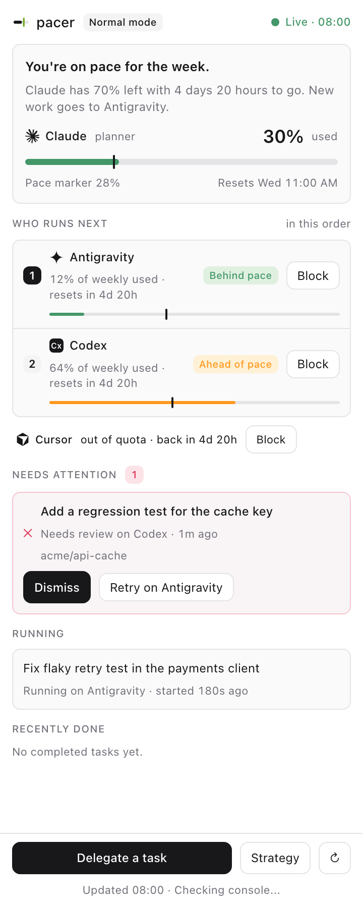

<p align="center">
  <picture>
    <source media="(prefers-color-scheme: dark)" srcset=".github/assets/pacer-logo-dark.svg">
    <source media="(prefers-color-scheme: light)" srcset=".github/assets/pacer-logo-light.svg">
    
  </picture>
</p>
<p align="center">Subscription budgets for AI coding agents</p>
<p align="center">
  <a href="https://github.com/lamtuanvu/pacer/actions/workflows/ci.yml"></a>
  <a href="https://github.com/lamtuanvu/pacer/stargazers"></a>
  <a href="LICENSE"></a>
  <a href="https://github.com/lamtuanvu/pacer/releases/latest"></a>
  <a href="https://scorecard.dev/viewer/?uri=github.com/lamtuanvu/pacer"></a>
</p>

Subscription budgets for AI coding agents: route and delegate coding work according to usage, pace and available executors.

A planner can spend its subscription too quickly while other coding agents have unused capacity. pacer compares usage against time until reset, learns your active hours from local session logs, and helps the planner reserve capacity for decisions and review. Claude Code can plan while Codex, Cursor, agy, BytePlus or local models execute; Codex, Cursor and OpenCode can also be planners.

<p align="center">
  <picture>
    <source media="(prefers-color-scheme: dark)" srcset=".github/assets/panel-dark.png">
    <source media="(prefers-color-scheme: light)" srcset=".github/assets/panel-light.png">
    
  </picture>
</p>

Rendered from the current plugin with sample data. [Roadmap](ROADMAP.md) · [Orca limitations](orca-plugin/README.md#known-limitations-orca-pluginapi-1-verified-on-orca-14224) · [Design system](design/README.md).

## Features

- Budget status, executor ranking and routing by task kind.
- Priority, even, burn-before-reset and cheapest-first pacing policies.
- Delegation, limit-triggered fallback, task tracking and explicit planner review.
- Planner skills and hooks, an optional stdio MCP server, and an Orca budget panel.
- Direct CLI execution or Orca workers, with per-task worktree placement in Orca.
- Rules-based classification, optional model adapters and local decision benchmarks.

## Install

Install the latest binary from [GitHub Releases](https://github.com/lamtuanvu/pacer/releases):

```sh
curl -fsSL https://raw.githubusercontent.com/lamtuanvu/pacer/main/install.sh | sh
```

This works once the repository is public and its first release exists. The installer verifies SHA-256 checksums; verify a downloaded binary's build provenance with `gh attestation verify <file> -R lamtuanvu/pacer`. `PACER_RELEASE_BASE` remains an override for another HTTPS or local `file://` release host. See [installation](docs/install.md) for source builds and installer options.

From a source checkout, use Bun 1.4.2 or newer:

```sh
bun install --frozen-lockfile
bun run build
mkdir -p "$HOME/.local/bin"
cp dist/pacer "$HOME/.local/bin/pacer"
export PATH="$HOME/.local/bin:$PATH"
pacer --version
```

The future npm package is `@lamtuanvu/pacer`; it is not published yet. The planned Homebrew tap is `lamtuanvu/homebrew-tap`; it has not been created. The command stays `pacer`.

## Quickstart

Install and authenticate your planner and at least one executor CLI first. For a Claude Code planner:

```sh
pacer init --planner claude-code
pacer install claude-code
pacer doctor
pacer status --json
pacer route docs --json
```

Run delegation in the repository you want the executor to edit. Supply a concrete scope and verification command:

```sh
pacer delegate --goal "Improve the setup instructions" \
  --kind docs --scope README.md --acceptance "test -s README.md" --json
```

Use the returned `id` in the next commands, replacing `TASK_ID`:

```sh
pacer wait TASK_ID --json
pacer tasks TASK_ID --json
# Review the diff in the reported worktree and run acceptance yourself.
pacer review TASK_ID --accept --json
```

Use `--reject` if the result does not satisfy the brief. For structured briefs, use `pacer delegate --brief-file brief.json --json` or pipe JSON to `--brief-file -`. [CLI and brief reference](docs/cli.md).

## How it works

The planner owns planning, decisions and review. `route` ranks configured, installed executors using usage readings and your strategy. `delegate` starts an executor, records its result and runs any supplied acceptance command. Provider limits can trigger fallback to another executor. The planner checks the diff and acceptance result before recording `review`; settlement alone is not acceptance.

| Mode | Planner policy |
| --- | --- |
| relaxed | Execute directly or delegate when useful; budget is behind pace or expiring. |
| normal | Delegate substantial execution; budget is on pace or unknown. |
| strict | Delegate execution and preserve capacity for decisions and review; budget is ahead of pace or near a limit. |
| emergency | Delegate execution; the planner's reserved budget is exhausted. |

Pace uses learned active hours, falling back to calendar time until enough history exists. Modes guide installed planner policies; supported hooks can guard planner subagent execution. `PACER=off` disables pacing enforcement for a session.

## Configuration and executors

`pacer init` creates `~/.pacer/strategy.yaml` from detected tools. Edit providers, pacing and routing there; `PACER_HOME` overrides the state directory. See [configuration](docs/configuration.md) and the [starter strategy](examples/strategy.yaml).

Native executor launchers support Codex (`codex`), Cursor (`cursor-agent`), agy and Claude Code (`claude`). OpenCode runs configured `provider/model` IDs, including BytePlus Coding Plan and local Ollama or LM Studio models. Usage support differs by provider; see [executors](docs/executors.md).

The CLI is the primary agent interface. `pacer install <planner> --mcp` optionally registers `pacer mcp`, exposing budget, routing, delegation, task and review tools over stdio.

## Orca plugin

Install the pacer CLI as well: the plugin talks to its local service. In Orca Settings > Plugins, add marketplace source URL `https://github.com/lamtuanvu/pacer.git` with ref `main`, then install **pacer** (`lamtuanvu.pacer`). To install a specific release directly, use `https://github.com/lamtuanvu/pacer.git#orca-plugin-v0.1.14` (replace the version with the release you want).

For local development:

```sh
pacer plugin install
pacer serve
```

Add the managed development directory printed by the installer to Orca Settings > Plugins and enable its declared capabilities. Re-running `pacer plugin install` migrates an older `pacer.pacer` development install in the same directory; reload and enable the new identity in Orca. The plugin targets Orca >=1.4.224 and shows a read-only status page with budgets, tasks, alerts, versions and setup instructions, plus notifications. The worker never starts or contacts consoles. Its only command, **pacer: Open**, points to `pacer dashboard` in a terminal for delegating, reviewing, blocking executors and changing settings until the pacer app ships. `pacer console` is deprecated. The bootstrap installer is unchanged. See the [information-only decision](docs/decisions/2026-10-15-orca-plugin-information-only.md), the [plugin guide](orca-plugin/README.md) and its [known limitations](orca-plugin/README.md#known-limitations-orca-pluginapi-1-verified-on-orca-14224).

## App

With the service running, `pacer open` opens the pacer app in your browser.
Track budgets and pace, delegate and review tasks, manage executors and accounts,
and change strategies, hosts and settings. Setup guides you through required
items; account sign-in and service installation show commands to run in a terminal.

The app is served locally by the daemon and signs you in through a one-time link.
Use `pacer open tasks` to open a screen, `pacer open --print` to print the sign-in
link, or `pacer open --logout` to sign out all browser sessions. See the
[app guide](docs/app.md) for screens, security and troubleshooting.

## Privacy

pacer sends no telemetry. Its budget and activity readers use these local sources:

- Claude rate-limit caches: `~/.pacer/cache/claude-rate-limits.json` and `~/.claude/state/budget/claude.json` (the newest available file).
- Codex rate limits: tails of recent `~/.codex/sessions/**/rollout-*.jsonl` files.
- Active-hour learning: timestamps extracted from `~/.claude/projects/*/*.jsonl` and Codex rollout logs over the last 28 days. The files themselves are read locally, including their other contents; the activity profile retains hour counts.
- pacer's own strategy, caches, limit/block marks, task records, executor output logs, decision logs, installation manifests and local link/service state under `~/.pacer` (or `PACER_HOME`).

BytePlus usage is read through `arkcli usage plan --product coding-plan`; metered OpenCode usage through `opencode stats --models --json --days 7`. Setup detects installed CLIs and may list local models with `ollama list` or `lms ls --json`. Integration commands inspect and edit planner configuration, skills and hooks, keeping backups. Delegation reads the supplied brief, repository Git state and executor reports; verification runs your acceptance command. Orca integration reads local runtime/worktree state and the bearer token for loopback HTTP.

Executors receive your brief and can access the selected repository under their CLI permissions; their services have their own data policies. Optional `ollama` and `jev` classifier adapters send decision state to their configured endpoints. The default classifier is local rules; external shadow calls require `classifier.shadow_external: true`. Classifier keys may be read from environment variables or `~/.pacer/secrets`. Release install/update commands download from GitHub Releases by default, or from your `PACER_RELEASE_BASE` override. No usage logs are uploaded for analytics.

## Star history

<a href="https://star-history.com/#lamtuanvu/pacer&Date">
  <picture>
    <source media="(prefers-color-scheme: dark)" srcset="https://api.star-history.com/svg?repos=lamtuanvu/pacer&type=Date&theme=dark">
    <source media="(prefers-color-scheme: light)" srcset="https://api.star-history.com/svg?repos=lamtuanvu/pacer&type=Date">
    
  </picture>
</a>

## Community

Read [Contributing](CONTRIBUTING.md), the [Code of Conduct](CODE_OF_CONDUCT.md), [Support](SUPPORT.md), [Security](SECURITY.md), [Governance](GOVERNANCE.md) and the [Changelog](CHANGELOG.md). GitHub community channels will become available when the public repository launches.

Licensed under [Apache-2.0](LICENSE); see [NOTICE](NOTICE).

pacer is an independent project and is not affiliated with Anthropic, OpenAI, Cursor, BytePlus or Orca. Product names are used only to describe compatibility.
