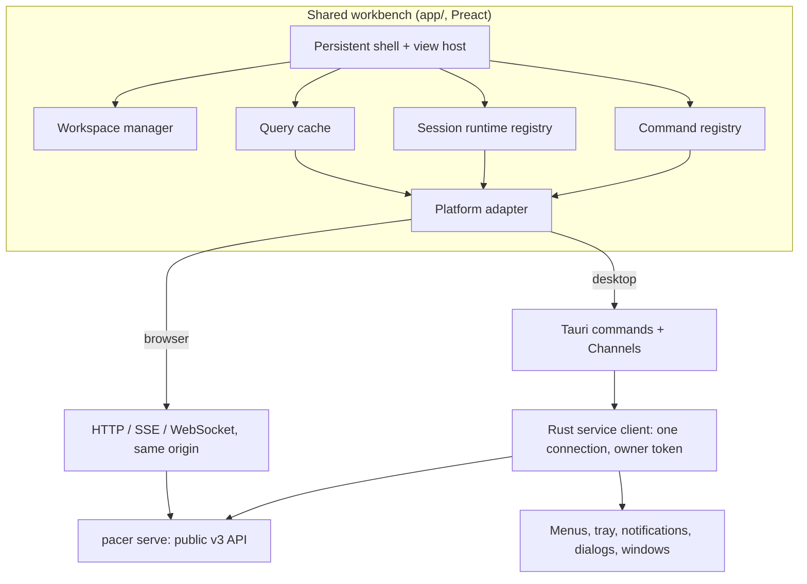

# Persistent workbench: native desktop feel with browser parity

Status: proposed, 2026-10-31. Source: [issue #527](https://github.com/lamtuanvu/pacer/issues/527) (the owner's architecture idea). This spec turns that idea into a buildable design and grounds it in the current code. It needs an amendment to D4 of the [clients ADR](../decisions/2026-10-16-clients-over-local-service.md) (section 9).

## 1. Intent

The desktop app feels like a web page in a frame, not a native app. The owner's principle: **navigation changes what is visible; it does not own the lifetime of sessions, connections or work.**

Native feel here means:

- The window is the app. It opens instantly, at the user's last context, before the service answers.
- It never reloads, goes blank or shows a full-screen loading state for something it has already shown.
- Local interaction (selecting, typing, opening a panel, switching sessions) never waits on the service.
- Losing the service changes a status indicator, not the workspace.
- It follows OS conventions: menus, shortcuts, cursor, selection, right-click, scrolling, window close versus quit.

The browser gets the same workbench and the same in-page behavior. Only the delivery and transport differ.

## 2. Why it feels like a webview today

Code audit at `bb163906`. Each item names the cause the design removes.

**The desktop window is a browser tab on localhost.**

- The window starts on a small bundled page (`desktop/ui/`). Rust then grants IPC to `http://127.0.0.1:<port>` at runtime and navigates the window there (`desktop/src-tauri/src/main.rs:955-1033`). First paint waits for the service and an HTTP page load.
- On a disconnect or service restart, Rust navigates the window back to the bundled recovery page and then to the service again (`main.rs:813-866`, `client.rs:949,1696-1706`). The whole UI and all in-page state are rebuilt.
- Rust already runs its own service client: owner token, `/v3/session/exchange`, hello and version gate, SSE lifecycle loop, notification actions (`client.rs:421-517,1084-1124`). The page opens a second, independent connection.

**The UI discards what it already has.**

1. `useQuery` keeps its result in per-instance state that starts empty. It reads the shared cache only in an effect after paint, so every mount renders `loading` first, even with cached data (`app/src/screens/task-shared.tsx:39-64`). Screens gated on `!data` show a skeleton that renders nothing for its first 150 ms (`app/src/ds/Skeleton.tsx:23-28`).
2. The lazy screen wrappers (`LazyTrace`, `LazyWorkspace`, `LazyDispatch`, `LazyTerminal`, `LazyThread`) keep the loaded module in `useState(null)` and resolve it again on every mount.
3. `Screen` is a `switch` with `key={route.id}` on detail views (`app/src/screens/Screen.tsx:17-32`). Every navigation unmounts the subtree, and nothing is kept alive.
4. Workspace tabs, selection and expanded cards are local state (`Workspace.tsx:60-62`). A task switch inside the Workspace shows a skeleton (`keepPreviousData=false`, `:76,:115`).
5. The xterm and its WebSocket are created and disposed in one effect whose dependencies include `live` and `control` (`app/src/term/term.tsx:28-102`). A refetch of `task.session` rebuilds the terminal. A new `SessionClient` has no offset, so a remount resets and replays the whole scrollback. Closing the socket releases control on the service (`src/session/viewers.ts:69`).
6. Redirecting hashes render route `loading`, which replaces the whole main area with a skeleton (`app/src/main.tsx:88`, `shell/Layout.tsx:161,179`).
7. Every hash change scrolls the work area to the top (`main.tsx:45`) and moves focus to `#main-content` (`navigation.tsx:20-22`).
8. Answer, thread, workspace composer and assistant drafts are local state and are lost on navigation.
9. Invalidation is broad. `store.refresh()` reopens SSE and refetches hello and the snapshot after config events, several actions and every answer (`app/src/data/store.ts:152-165`, `data/actions.ts:62`). The default query revision is all invalidations (`task-shared.tsx:36`). A connection blip refetches every mounted query (`store.ts:144`, `task-shared.tsx:53`).
10. Disconnect wraps the app in `<fieldset disabled>` (`app/src/shell/AppFrame.tsx:60,70`).
11. Mutations show only button spinners. A sent thread message appears only after `msg.send` and a log reload (`screens/session/Thread.tsx:76-87`).

**Web defaults leak through.**

- No `user-select: none` on chrome; double-clicking a label highlights it and ⌘A selects the window.
- `cursor: pointer` on about 30 controls and `not-allowed` on disabled ones.
- No `contextmenu` handling: WebKit's menu, including Reload, appears.
- No `overscroll-behavior` on the root; `body { overflow: hidden }` applies only after an async desktop flag (`app/src/styles.css:4`, `main.tsx:29-31`).
- Links and images are draggable.
- Settings is bound to a bare `,`; the registry ignores most ⌘ combinations, so `Mod-n` never fires (`app/src/keys/registry.ts:49-53`); there is no ⌘F, ⌘1–9 or ⌘[ / ⌘].

**The macOS shell is thin.** The app menu is Tauri's default with no app commands. There is no Rust-to-page command channel. Deep links navigate the window. Confirmations use `osascript` and Linux has none. Desktop detection reads `__TAURI__` in several places (`data/control.ts:24`, `data/api.ts:8`, `Updates.tsx:123`).

**Already right, and kept:** the command registry and ⌘K palette, `:focus-visible` rings, system fonts, dark mode with native theme, the overlay title bar and drag regions, tray popover, actionable notifications, single instance, deep links, launch at login, saved window geometry, hide on close, and Dock reopen.

## 3. Goals, non-goals, anti-goals

**Goals**

- G1. Desktop first paint comes from the app bundle and the last workspace, not from the service.
- G2. Returning to a session visited recently shows its content synchronously, with draft, scroll, follow mode, selected tab, panel and file, and focus restored.
- G3. Navigation never reconnects a terminal or changes control.
- G4. A service restart or disconnect never reloads the page, on desktop or in the browser.
- G5. The desktop app follows macOS conventions for menus, shortcuts, selection, cursor, right-click and scroll.
- G6. The browser gets G2, G3, G4 and the in-page conventions that apply to it.

**Non-goals**

- Changing framework. Preact stays (UI-1). React is not an option here.
- Changing what the service owns or exposes beyond the additions in section 10.
- Multiple windows, Windows support, or a detached terminal window.
- Offline mutation queues. Actions that need the service are unavailable while it is unreachable.

**Anti-goals** (failure even if it works)

- A second task engine or task database in the client or in Rust (ARCH-1, D1).
- Rust or a client reading private service files beyond the owner token it already uses.
- A generic HTTP, shell, file or arbitrary-URL proxy in Rust.
- Weakening SEC-3, SEC-4 or SEC-8 (Host check, no CORS, Origin check, Strict cookie, scoped capabilities).
- Showing an unconfirmed mutation as done.
- Silently taking or keeping terminal control the user released.
- A desktop-only fork of screens or behavior. Desktop-only code is limited to the platform adapter and the Rust shell.
- Writing transcripts, terminal output or credentials to client storage.

## 4. Architecture

| Owner | Holds | Persistence |
| --- | --- | --- |
| Service | Tasks, results, PTYs, scheduling, control holder | Service storage (unchanged) |
| Rust service client (desktop) | Connection, token, event cursor, terminal sockets | Memory |
| Query cache | Received entities with revisions | Memory, bounded |
| Session runtime registry | Terminal output ring buffers, stream offsets, control intent | Memory, bounded |
| Workspace manager | Open sessions, drafts, scroll, follow mode, selections, focus target | Memory; drafts and the open-session list in local storage, scoped by service identity |
| Tauri shell | Window geometry, theme, tray, menu state | Existing desktop preferences |

Screen components render this state. Mounting or unmounting a component never opens, closes or owns a connection, runtime or service operation.

## 5. Desktop delivery: bundle the UI, Rust owns the connection

### 5.1 Bundled UI

The desktop app ships the same `app/` build as its `frontendDist`, loaded from the app's own protocol. The browser keeps loading `/app/` from `pacer serve`. One codebase, two deliveries; D4's goal ("never a second UI codebase") holds.

Build changes in `app/build.ts`:

- A second output target for desktop with relative asset paths (today `index.html` hardcodes `/app/app.css` and `/app/app.js`).
- The page reads an API base from the platform adapter instead of assuming the same origin.
- The service injects a per-request style nonce today (`src/serve/app-routes.ts:65`). The desktop target uses the Tauri CSP's own nonce or hash handling instead. Builder: pick the mechanism that keeps the desktop CSP no looser than `default-src 'self'` plus what the app needs (SEC-8).
- Bundle budgets (UI-3) apply to both targets.
- The bundled startup and recovery shell in `desktop/ui/` is folded into the app as states of the persistent shell (connecting, outdated service, stuck, sign-in), so the window never navigates between documents.

The window loads the bundle once and never navigates afterwards. Deep links, tray actions and notification clicks become route events (section 8.3).

### 5.2 Rust service client

Rust is the only desktop component that talks to the service. It already authenticates with the owner token and runs the lifecycle loop. It is extended to serve the page:

- **Operations:** one command `service_call(op, params)` that forwards only operations listed in the service's hello `ops`. Results and typed errors (including `conflict`) pass through unchanged. The page's API client calls it instead of `fetch`. It is an allow-listed op forwarder, not an HTTP proxy: Rust builds the request URL itself from the fixed service base.
- **Events:** one `ipc::Channel` per page that carries the v3 event stream. Rust keeps the SSE connection and its `since` cursor across page reloads and service restarts, and replays from the cursor on reconnect. The service already stores events by sequence and emits a `reset` event when the cursor is older than its oldest stored event (`src/api/events.ts:71-96`). Rust passes that through as one `resync` message, and the page refetches the snapshot in place. A long restart therefore costs one snapshot read, never a page reload.
- **Connection status:** pushed on the same channel (`connecting`, `connected`, `reconnecting` with attempt and next retry, `incompatible` with reason). It replaces the recovery-page navigation.
- **Terminal streams:** `terminal_attach(target, from)` opens or reuses the session WebSocket in Rust and streams frames over a Channel. `terminal_send`, `terminal_resize`, `terminal_take(force)`, `terminal_release` and `terminal_detach` map to the existing session frames. `target` is a task session (`/v3/tasks/:id/session`) or a host terminal (`/v3/terminals/:uuid/session`); Rust uses the v3 routes only, so the planned /v2 removal does not affect it. Rust holds the socket; the page holds the runtime state (section 7). Builder: define per-Channel buffering and a drop-to-snapshot rule when the page falls behind.
- **Non-op routes:** the page also uses routes that are not hello `ops`: the assistant turn stream (`/v3/assistant/turns/:id/stream`), attachments (`/v3/attachments` upload, list and read) and the task log follow stream (`/v2/tasks/:id/log?follow=1`). Each gets its own typed command with a fixed route: `assistant_turn_stream(id)` and `task_log_follow(id, from)` stream over a Channel; `attachment_upload`, `attachment_list` and `attachment_read` are plain commands with the service's existing size limits. Any new non-op route the page adopts gets a typed command in the same change. There is no general route forwarder.
- **Caller identity:** the service reads `X-Pacer-Client` and `X-Pacer-Client-Instance` on every authenticated request and uses them for the interactive driving lease and the timeline (`src/api/http.ts:82-86`, `src/session/send.ts:22-30`). The lease is cooperative, not a security boundary. Rust sends `X-Pacer-Client: app` and the per-window instance ID the page generates (as `app/src/data/api.ts` does today), so a desktop window contends with a browser window exactly as two browser windows do.
- **Hello and version:** Rust keeps `check_hello` and the service version gate. The page receives the result as a status and shows the outdated-service and outdated-app states inside the shell.

The SSE and WebSocket routes keep requiring the same-origin cookie or the bearer token. Rust uses the bearer path. No CORS, Origin or cookie rule changes are needed.

Capabilities: the main window gets a static capability for the bundled origin covering only these commands and the existing `client_control` commands. The runtime grant to the service origin is removed. Every command keeps checking the calling window label.

### 5.3 Notification ownership

On desktop, Rust owns notification delivery, as it already does. The page never shows OS notifications. In the browser, nothing changes. Builder: confirm the browser app does not also notify when the desktop app is running; if it does, gate it on an existing presence signal or note it as a follow-up.

## 6. Persistent workspace (both clients)

### 6.1 Render from cache first

- `useQuery` seeds its first render synchronously from the shared cache entry for `[op, params]`. When an entry exists it renders it with `updating: true` and revalidates in the background.
- Lazy screen modules are kept in a module-level variable once resolved, so a second mount is synchronous.
- A full skeleton appears only when there is no usable data. `keepPreviousData` becomes the default for detail views.
- Redirecting routes resolve before render (`router.ts`), so the `loading` route no longer replaces the main area.
- Expensive reads (diffs, full logs, file contents) load when their panel is visible, not when a session is selected.

### 6.2 Workspace manager

A module-level store keyed by `serviceIdentity + taskId` (and `section` for non-task screens). Per key it holds:

- drafts (answer, thread message, workspace composer, assistant),
- scroll position per scroll container and follow mode for logs and terminals,
- selected workspace tab, right-hand tab, panel and file, and expanded cards,
- the last focused element's stable identifier.

Screens use `useWorkspaceState(key, field, initial)`. On activation, a view restores scroll and focus from the manager. The global scroll reset and focus jump on hash change are removed; a new view with no saved state starts at the top with focus on its heading, as today.

Drafts and the open-session list persist to local storage under the service identity. Nothing else persists. `useDraft` (session storage) is folded into this.

### 6.3 Keep-alive view host

`Screen` becomes a view host:

- Detail views (task workspace, trace, session thread) are keyed by task ID and kept mounted after they are left, up to a cap. Inactive views are `hidden` and `inert`.
- My call: the cap is 5 detail views, least recently used first out. The cap is a constant to tune from measurement.
- Inactive views pause their own polling and detach their terminal renderer (section 7).
- An evicted view unmounts. Its state is in the workspace manager and its data in the query cache, so it returns at the same place without a skeleton when the cache still holds data.
- Non-detail screens (Dispatch, Tasks, Settings, Insights) are not kept alive but restore scroll and selection from the manager.

### 6.4 Targeted invalidation

- Event payloads that already carry the entity are applied as upserts (as `store.ts:45-97` does) and do not trigger refetches.
- `store.refresh()` runs only on a gap that cannot be replayed, a protocol change or a service identity change. Config events invalidate only the query keys tied to that config section.
- Query revisions are per entity. `task.get` no longer depends on every activity entry for the task, only on the task revision and its own messages.
- A disconnect marks queries stale instead of clearing the cache. On reconnect each visible query revalidates once.

### 6.5 Connection loss

- The shell shows a connection status in the top bar and a non-modal banner after a short grace period (my call: 2 s).
- Content stays visible and drafts stay editable. Only controls that need the service are disabled, with a reason. The global `<fieldset disabled>` is removed.
- On desktop, the incompatible and never-connected states are full shell states; every other disconnect is a banner over the intact workspace.

### 6.6 Pending feedback

- A sent thread message or answer appears at once in the list, marked "Sending", and becomes normal when the service confirms it (result or event). On failure it stays with the error and Retry and Discard.
- Other actions keep the busy state on their control, and the delayed busy rule stays.
- Nothing is shown as done before the service confirms it.
- An uncertain outcome (timeout, lost connection mid-request) is resolved by reading the entity before offering Retry. Destructive operations are never retried automatically.

## 7. Terminal lifetime

A session runtime registry, module-level, keyed by `serviceIdentity` and the session target (task ID or host terminal ID). When the service reports a new attempt for a task, the runtime resets its buffer and offset and reattaches. Each runtime holds:

- the connection (browser: a `SessionClient` WebSocket; desktop: a Rust terminal attachment),
- a bounded output ring buffer and the last stream offset,
- control intent: `watching`, `driving`, or `released` (released by the user and not to be retaken automatically),
- the last known control holder and viewer count from `control` frames.

Rules:

- The xterm component attaches to the runtime on mount and detaches on unmount. It never creates or closes connections. Changes to `task.session` data update the runtime; they do not rebuild the terminal.
- On attach, the renderer writes the ring buffer; if the buffer cannot cover the gap, it reconnects with `?from=<offset>` (supported by `src/serve/session-ws.ts:89-90`) or falls back to the service snapshot. `SessionClient` already resends its offset on its own reconnects (`app/src/term/client.ts:30`); the loss today is on remount, because each mount creates a new client. The registry keeps one client per target across mounts.
- Opening a workspace watches without taking control (workspace-first spec). The app never takes control on its own after the user released it. Auto-take on first connect stays off in the Workspace.
- **Hidden views and control.** Closing a socket releases control on the service (`viewers.ts:69`). So:
  - a runtime whose intent is `driving` keeps its socket while its view is hidden, so navigation does not release control (G3);
  - a `watching` runtime keeps its socket while its view is kept alive; when the view is evicted it closes after an idle period (my call: 60 s) and keeps its buffer and offset for a later reconnect;
  - a `driving` runtime is never closed by eviction. If the user leaves it hidden for a long time it stays in control, as it would with the terminal visible. Builder: show the user they are in control of a hidden session in the shell's status area, so this is never invisible.
- Viewer cap: the service allows 16 viewers per session (`viewers.ts:83`). The registry keeps at most one connection per terminal per client.
- Memory cap: my call: 1 MiB of output per runtime and 16 runtimes, least recently used first out (never a `driving` one).
- Explicit actions keep their meaning: Hand back sends `release` and sets `released`; Stop task is a service operation; closing a terminal tab detaches and lets the idle rule close it.

## 8. Native behavior

### 8.1 Base styles

A base layer in the design system, applied to the app frame in both clients:

- `user-select: none` on chrome (rail, top bar, status bar, buttons, tabs, headings, labels, pills); `user-select: text` on content (prose, results, code, logs, diffs, file viewer, inputs, terminal).
- `cursor: default` on buttons and controls; `cursor: pointer` only on real links to content; disabled controls dim without `not-allowed`.
- `overscroll-behavior: none` on `html` and `body`, set statically, not after the async desktop flag; scrolling stays inside panes.
- `-webkit-user-drag: none` and `draggable="false"` on nav links, icons and UI images. Content images and the plugin sort handle keep their behavior.
- `::selection` uses a design token. Builder: use the system accent where the webview exposes it (`AccentColor`), otherwise the existing token.

Browser parity: these apply in the browser too. They match desktop-app conventions and do not remove anything a browser user needs; content stays selectable.

### 8.2 Right-click

- On chrome, the default context menu is suppressed.
- In inputs, selectable content and the terminal, the default menu stays (copy, paste, look up). On desktop, WebKit's Reload and Inspect items must not appear in release builds.
- App-specific context menus (for example, task row actions) are a follow-up, built on the command registry.

### 8.3 Commands, shortcuts and the app menu

- The command registry is the single source of actions. Buttons, the ⌘K palette, keyboard shortcuts and the native menu all dispatch command IDs.
- The key registry matches ⌘ combinations: ⌘, Settings; ⌘N New task; ⌘F find in the current view; ⌘1–9 primary sections; ⌘[ and ⌘] back and forward; ⌘K palette (kept); ⌘W close the current tab or panel, then hide the window. The bare `,` binding is removed. The dead `Mod-n` binding is fixed.
- On desktop, Rust builds the app menu: App (About, Settings ⌘,, Updates, Hide, Quit ⌘Q), File (New task ⌘N, Close ⌘W), Edit (standard items), View (sections, toggles, Enter Full Screen), Go (Back, Forward, Dispatch, Tasks, Needs you), Window (standard), Help (docs, report an issue). Each app item carries a command ID. Rust sends the ID to the page over the event channel, and the page runs it through the registry. Menu enabled state follows the page's command availability, sent back by the page.
- Deep links, tray items and notification clicks are sent as route or command events. The page routes in place; the window never navigates.
- Linux gets the same menu where the platform shows one.

### 8.4 Platform adapter

`app/src/platform/` with one interface and two implementations (browser, desktop). It covers: service calls, event subscription, terminal attach, connection status, open external URL, confirmation dialog, file and folder pickers, clipboard, notifications (browser only), window controls and the capability checks now in `data/desktop.ts`. All direct `__TAURI__` reads move behind it.

### 8.5 Native dialogs

`tauri-plugin-dialog` replaces the `osascript` confirmations and gives Linux dialogs and native file and folder pickers.

### 8.6 Not in scope here

Vibrancy, extra windows, a Dock badge and activation-policy options are follow-ups. They do not block native feel.

## 9. ADR amendment

D4 of the clients ADR says the desktop app "loads the same bundle the service serves at `/app/`". Proposed amendment: the desktop app ships the same `app/` source as a bundled build and reaches the service only through its Rust service client, which forwards public API operations, events and terminal streams with the service's own auth and error semantics. D1, D2, D3 and D6 are unchanged.

Consequences recorded with the amendment:

- The bundled UI and the service can differ in version. Rust's hello check and service version gate stay the authority; the shell shows actionable mismatch states (update the app, update the service, or continue with a known older service, as today). When continuing with an older service, the page gates features on the hello `ops` and `events` lists, as `store.ts:27-29` already does; a feature whose op is missing is hidden or shown as unavailable with the reason.
- The desktop updater now also updates the UI. Release notes for the desktop app cover UI changes.
- SEC-8 is restated: a static capability for the bundled origin covering only the listed commands replaces the runtime grant to the service origin.

The amendment goes through the constitution's process and lands with or before the code that bundles the UI.

## 10. Service changes

None are required for the core design: the bearer path, caller-identity headers, hello `ops`/`events`, SSE `since` with `reset`, terminal `?from=` and the non-op routes in 5.2 already exist. One existing gap matters for later: task log follow exists only at `/v2/tasks/:id/log`. It needs a v3 route before the planned /v2 removal; that is tracked with the /v2 removal, not added here. If the builder finds the SSE replay window too short for a service restart, a longer replay or a cursor-validity signal is added to the public protocol (API rules), not as a desktop-only contract.

## 11. Delivery order

Each step is useful on its own and ships as its own PR.

1. **Base styles, right-click and ⌘ shortcuts** (8.1, 8.2, key registry part of 8.3). Both clients.
2. **Render from cache and targeted invalidation** (6.1, 6.4). Both clients.
3. **Workspace manager, keep-alive view host and connection loss** (6.2, 6.3, 6.5). Both clients.
4. **Session runtime registry** (7). Both clients.
5. **Platform adapter** (8.4) with the browser implementation only; no behavior change.
6. **ADR amendment, then bundled UI and Rust service client** (5, 9). Desktop.
7. **App menu, command bridge, route events and native dialogs** (8.3, 8.5). Desktop. This step does not depend on step 6: the current page on the service origin already has IPC through its runtime capability, so the command and route events reach it through the platform adapter either way. It may ship before step 6 if the ADR amendment is still under review.
8. **Pending feedback** (6.6). Both clients.

Steps 1–4 fix the in-page causes for both clients without the ADR change. Step 6 removes the remaining desktop reloads.

## 12. Validation

Targets (proposed; measured, not guaranteed):

| Interaction | Target |
| --- | --- |
| Return to a kept-alive session | Content visible in the first frame; ≤ 100 ms p95 to interactive on the agreed test machine |
| Return to an evicted session with cached data | No skeleton; ≤ 250 ms p95 |
| Switch sessions | No full-screen loading state; no terminal reconnect |
| Desktop cold start | Shell and last workspace visible before the service answers |
| Service restart | No page navigation; banner; workspace and drafts intact |

Instrumentation: performance marks for route activation, first content frame and terminal attach, read by the live harness. A baseline is recorded before step 2.

Live journeys (`bun run live`, CT-11), in both the browser and the desktop app:

1. Open A, scroll the log, type a draft, open a file. Switch to B, then back to A: draft, scroll, file and focus restored; no terminal reconnect (no new WebSocket in the network log).
2. Take control in A, switch to B and back: still in control. Hand back, switch away and back: still released.
3. Back and forward through five sessions: no skeletons for cached ones.
4. Restart the service: no navigation; banner shown; drafts kept; terminals resume from offset.
5. Visit more sessions than the cap: evicted sessions return without a skeleton; a driving runtime is never evicted.
6. Browser and desktop open on one task: both converge; control conflicts use the existing take-over prompt.
7. Desktop: menu items and ⌘ shortcuts run the same commands as the palette; right-click on chrome shows no WebKit menu; a deep link routes in place.

Regression tests: `useQuery` first render from cache; view host LRU and `hidden`/`inert`; runtime registry attach, detach, eviction and control intent; workspace manager persistence scoping; key registry ⌘ matching; Rust op allow-list rejects unlisted ops; Channel resync on gap.

Reviews: UI and accessibility (focus restoration, `inert`, live region for the connection banner), architecture (ARCH-1, ARCH-2, D4 amendment), security (SEC-3, SEC-4, SEC-8, the op forwarder), protocol-compat if section 10 adds anything.

## 13. Left to the builder

- Exact cap values, timeouts and buffer sizes, tuned from measurement (defaults marked "my call" above).
- The desktop CSP and style-nonce mechanism within SEC-8.
- Channel buffering and backpressure details.
- Module and file names inside `app/src/` beyond `app/src/platform/`.
- Which existing screens adopt `useWorkspaceState` first, as long as all listed drafts and selections are covered by the end of step 3.

## 14. Calls made in this spec (not yet confirmed by the owner)

- Rust owns the desktop connection from the start of step 6, instead of the bundled page calling `127.0.0.1`. Reason: SEC-3 and SEC-4 (no CORS, Origin check, Strict cookie) would otherwise have to be weakened, and Rust already holds the owner token and a lifecycle connection.
- Steps 1–4 come before the bundled UI because they fix both clients and need no ADR change.
- A driving runtime keeps its socket while hidden, because closing it releases control. This follows the issue's rule that navigation must not change control; the shell shows when you are in control of a hidden session.
- Base styles apply in the browser too.
- Defaults: 5 kept-alive views, 16 runtimes, 1 MiB per runtime, 60 s idle close, 2 s banner grace.
