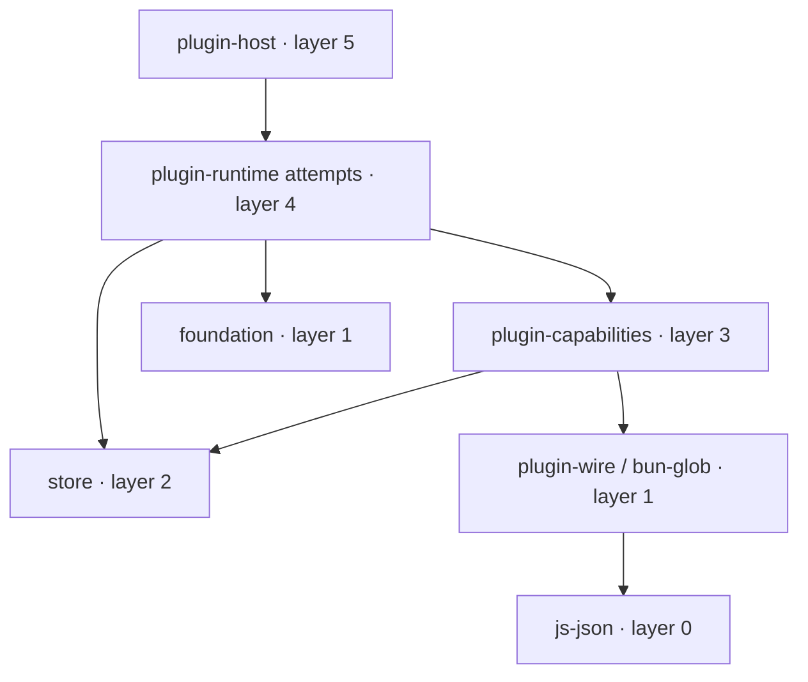

# Plugin capability and attempt ownership split

Date: 2026-11-03. Status: coordinator implementation decision; design and plan passed independent builder/project review. Product implementation follows coordinator authorization and remains subject to final project review.

## Intent

Split the unpublished native plugin runtime before exact-task-text caller migration grows it beyond CRATE-1. The implementation baseline is commit `a185e527f270e73c50eee7c9fd6aa59674f00352`, tree `b9052384d9f82501825995faf2816ac9638a0d59`, which integrates main while retaining the independently reviewed P4b sources: 11,988 runtime LOC, only 12 below the 12,000 hard limit. The required seam is already named in [ADR 0019](../decisions/0019-native-plugin-runtime-ownership.md) and the [crate plan](../../.project/rules/rust-crates.md): pinned byte/process capabilities versus executor-attempt ownership.

The coordinator selected the layer arrangement below after the dependency audit. This is an internal implementation decision made under the existing M2 scope, not a claim of separate user approval of this design. Existing TypeScript behavior remains authoritative.

## Approaches and decision

| Approach | Tradeoff | Decision |
| --- | --- | --- |
| New capability crate at layer 2, runtime 3, host 4 | Keeps layer numbers, but cannot retain the existing `From<StoreError> for BrokerError` implementation: its defining crate cannot depend on Store2, and the attempt crate would own neither type. Requires error adapters and locked-callback changes. | Rejected for this behavior-preserving split. |
| New capability crate 3, runtime 4, host 5 | Keeps the error and its Store2 conversion together, preserves implicit conversions and public imports; updates the planned layer map. | **Selected by the coordinator.** |
| Keep runtime as lower owner; add an attempt crate | Cohesive, but moves more files and breaks direct runtime attempt-module imports unless a cycle is reintroduced. | Rejected for this split. |

The capabilities→store edge exists **only** to preserve the existing StoreError conversion contract. It introduces no TaskStore use, task mutation, alternate state format or capability authority. Registry/RPC admission and reqwest remain in plugin-host; no client operation is registered.

## Ownership and files

Create unpublished `pacer-plugin-capabilities` in `crates/plugin-capabilities`, version `0.1.0`, layer 3, target ≤5,000 LOC, no heavy dependencies. Move these 13 source files from runtime with their included tests/assets:

- `authority.rs`, `credentials.rs`, `host_lease.rs`
- `native_bundle.rs`, `native_command.rs`, `native_duplex.rs`, `native_hosts.rs`
- `native_process.rs`, `native_read.rs`, `native_ssh.rs`, `native_write.rs`
- `spawn_spec.rs`, `work_lease.rs`

Their current total is **4,102 LOC**. Move `native_read/tests.rs`, `native_write/tests.rs` and `native_ssh/scripts.json` beside their owners. Keep the runtime `work_lease` integration test as a facade compatibility test using its current runtime import.

Keep these 18 source files in runtime, now layer 4:

- `native_git.rs`, `native_orca.rs`, `native_remote.rs`, `native_worktree.rs`, `remote_transport.rs`
- `native_run.rs`, `native_run/directory.rs`, `native_run/state.rs`
- `orca_attempt.rs`, `orca_attempt/client.rs`, `orca_attempt/evidence.rs`, `orca_attempt/journal.rs`, `orca_attempt/lane.rs`, `orca_attempt/launch.rs`, `orca_attempt/supervision.rs`, `orca_attempt/wire.rs`
- `orca_policy.rs`, `orca_prompt.rs`

Their current total is **7,787 LOC**; existing root wiring/contracts add 99 LOC before redistribution. Keep `native_run/wrapper.sh`, `orca_executor_contract.txt` and Orca included tests in runtime. Git/worktree/remote modules stay here because they persist task intents/receipts. RunDirectory stays with task attempts and its Store2 task-id validation. Orca policy, client/journal and attempt fields remain one private ownership unit.

These are baseline bucket counts, not projected final measurements. Measure both crates after glue/re-exports and all parallel changes. If runtime exceeds 8,000 LOC, record the concrete current-M2 follow-up **Orca attempt/session ownership versus direct/remote run and transfer ownership** in ADR 0019 and the milestone plan, with the measured justification. Any crate above 12,000 must be split further before integration; neither target nor hard limit changes.

## Contracts and cycle breaks

**One error and effect identity.** Move the existing `BrokerError` enum and `CapabilityEffect` trait definitions to the new crate without changing variants, messages, signatures, defaults or lossless delivery. Its root re-exports WireReply/Utf16String, transfers and JS semantics from the same existing dependencies.

Move the existing `From<pacer_store::StoreError> for BrokerError` impl into a private `store_interop.rs` beside the error's defining crate. Keep that impl's mapping exactly: `AuthorityError::Denied("executor run owner or source changed")`. The private module may copy the existing small denial helper so the impl body can remain verbatim. Keep the public `runtime::native_run::denied` function unchanged. Do not substitute native_command's different denial message, add a new public error wrapper, or alter implicit `?`/`with_task_lock` callbacks. The private helper location is the design author's routine implementation choice.

**Authority owns grants.** Move only `OrcaAttemptResource`, `OrcaLiveResource` and `ORCA_PROVIDER` from native_orca into lower `authority.rs`, preserving derives, camelCase names, fields and value. Point lower authority's provider check at its local constant. High native_orca re-exports these names; its TaskStore-backed dispatch and session/live owner traits stay high. This removes the low→high cycle without widening private session/journal/descriptor state.

**Facades remain source-compatible.** Lower lib exposes the moved public modules/types. Runtime re-exports them and keeps its high modules; host retains its runtime facade. Preserve root aliases and paths including `pacer_plugin_runtime::native_process::Image`, `native_command`, `native_ssh`, `authority`, and both runtime/host `native_orca::{OrcaAttemptResource, OrcaLiveResource, ORCA_PROVIDER}`. These must be aliases of the same definitions, not adapters or duplicate resource/error types. The public StoreError conversion remains available through both facades.

Existing pinning, no-follow checks, argument vectors, cancellation/Drop cleanup, opaque stages, lease/receipt ordering, lock/CAS, strict validation, error variants/messages, UTF-16 handling and deadlines are invariant. No private field becomes public merely to make the move compile.

## Dependency and policy changes

Use the current versions/features only. Lower ownership needs bun-glob, plugin-wire, serde/serde_json, thiserror, tokio, base64, uuid, nix, libc, url, rusqlite, sha2, plus Store2 solely for interop. Runtime retains only dependencies its high modules use, including store/foundation and the new capability edge. Remove unused edges only after compiler/dependency checks; do not upgrade packages or change optional/default features.

The workspace already includes `crates/*`; no root workspace-member/profile change is needed. Update Cargo.lock path-package edges, `xtask/crates.toml`, the planned-crate table, ADR 0019, context, README ownership and M2 ledger. Set capabilities/runtime/host to **3/4/5**; keep reqwest allowed only at host. Current source has no crate depending on host and host is runtime's only direct dependent; recheck this before editing.

This updates the planned layer map while preserving CRATE-4's strictly downward edges. It changes no rule ID, limits, heavy list or exception, and proposes no constitution amendment. If independent governance review finds that implementation would relax an actual rule rather than update registry/ownership metadata, surface the exact clause and use the amendment process before proceeding; do not silently waive it.

## Mechanical moves and intentional byte changes

Hash every moved file before and after. Twelve lower production files should move byte-for-byte; authority changes declarations/provider reference. The remaining moved module headers/relative references change only where compilation proves necessary and must be individually listed. Included test files and SSH script JSON retain bytes. High run/orca files change only the relocated conversion/declarations/imports; all other high bodies/assets retain bytes.

Intentional edits are new crate/lib/private interop wiring, lower authority declarations, high/root re-exports, manifest/lock/registry edges, the Bun fixed-script test's relocated JSON import, compatibility tests and ownership documentation. `wrapper.sh` and executor-contract bytes/paths stay unchanged. No Stage3 callback migration, parity fix, schema generation, runtime cutover, asset regeneration or dependency upgrade is bundled.

## Acceptance and validation

- Workspace all-target compilation plus facade tests prove lower/runtime/host use one type/trait, serialize the same grants, and preserve the exact StoreError conversion variant/message.
- Existing capability/attempt fixtures, including cancellation and cleanup adversarial tests, pass through the original host imports. The fixed-script test proves SSH scripts and executor contract remain identical to TS.
- Strict affected clippy/fmt and real xtask LOC/dependency checks pass with the actual final registry/layers; no unpublished import cycle or orphan impl remains.
- CRATE-9 records **four actual timing runs**: baseline clean and leaf lifecycle rebuild, candidate clean and leaf lifecycle rebuild. Commands/features/profile/environment match; retain HTML, wall times and source hashes. Shared-host/cache differences preclude an unsupported speedup claim.
- Independent builder/project review covers this design/plan before implementation; final architecture, persistence/error and security review covers the exact implemented content and all intentional byte changes.

The new libraries remain unserved. Live stays **UNVERIFIED** under the recorded 2026-11-01 M2 library exception, with first cutover validation still required; no native live PASS follows from moving files. The detailed implementation/evidence plan stays under ignored `.work/plans/` as repository policy requires. Coordinator owns implementation sequencing, commits/integration and later Stage3 authorization.
