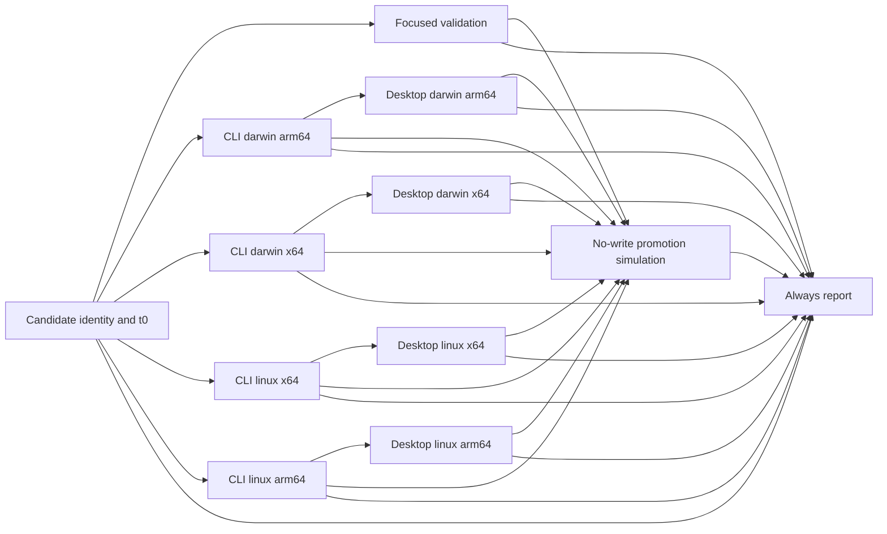

# Hosted lower-bound release build benchmark

This one-off benchmark measures how long GitHub-hosted runners take to build,
package, smoke and simulate promotion of an unsigned candidate. It is
**not a 30-minute release result** and must never be reported as one. It exists
to disprove, or bound from below, the viability of a 30-minute release on hosted
runners. Production release, tag, desktop, registry and CI workflows are unchanged.

## Limitations

The report artifact and step summary repeat these statements verbatim:

- Lower bound only: excludes Prepare PR, review and merge, tag creation, signing, notarization, publication and post-publication verification.
- Unsigned builds, focused validation and a no-write promotion simulation; the full test suite is not on this critical path.
- Fresh GitHub-hosted runners with no caches; one trial observes current queue conditions and does not predict others.
- Exceeding 1800 seconds disproves a 30-minute release on this design; finishing within it does not prove one.

The report always sets `fullReleaseDeadline: "UNVERIFIED"`. Its `lowerBound`
field is `EXCEEDS_DEADLINE`, `WITHIN_DEADLINE` (complete and within 1800 seconds)
or `UNVERIFIED` (incomplete). Even a `PASS` verdict means only that the build
lower bound was measured within 1800 seconds.

## Trigger and isolation

`.github/workflows/release-build-benchmark.yml` has exactly one trigger: a push
to the literal branch `benchmark/release-build-lower-bound`. A
`workflow_dispatch` workflow that exists only on a non-default branch is not
discoverable in the Actions UI or API, so dispatch is not used. There is no
schedule, pull request, tag, `workflow_run` or reusable-workflow trigger. A push
event runs the workflow file at the pushed commit, so the file never needs to
reach `main`. Do not open a pull request from, or merge, the benchmark branch.

Every job is gated on `github.repository == 'lamtuanvu/pacer'`, the `push`
event and the exact `refs/heads/benchmark/release-build-lower-bound` ref; the
reporter adds `always()` within the same guard. A fork or any other ref skips
every job. Each script invocation also checks the Actions environment and event
payload: event name, ref, ref type, ref name and workflow ref, `after` equal to
`GITHUB_SHA`, the head commit, a non-deletion push and the repository. The run
metadata must be the same run ID, attempt, SHA, `push` event, branch and
workflow path.

The token has only `contents: read` and `actions: read`. There are no secrets,
variables, environments, signing identities, certificate imports or publication
steps. Every action is pinned to a full commit SHA. Checkouts use the event's
immutable `github.sha` without persisted credentials. There is no Actions or
build cache: `setup-bun` runs with `no-cache: true`, and no cache action is used,
so nothing is restored from another branch or run. Artifact downloads come only
from the current run. Artifacts are retained for seven days and are not releases.

## Running a trial

Only after the reviewer approves the exact commit, a maintainer pushes it:

```sh
git push origin <reviewed-sha>:refs/heads/benchmark/release-build-lower-bound
```

Each push to the branch is a new trial, and no concurrency group cancels an
earlier one. A commit message containing a skip-CI directive suppresses the run.
After collecting evidence, delete the branch:

```sh
git push origin --delete benchmark/release-build-lower-bound
```

GitHub does not run push workflows for a branch deletion, and the scripts refuse
a `deleted` push event regardless. Push events carry no inputs,
so the candidate requires the package, Tauri and desktop Cargo versions at the
SHA to match. Rerun **all jobs** for a fresh attempt. Rerunning only failed jobs
can lack current-attempt handoffs and fails closed. A rerun keeps the original
run creation time, so use a new push for an independent timing trial.

## Variants and DAG

All builds use Bun 1.4.2, the repository's Rust 1.99.0 toolchains, frozen Bun
lockfiles, locked Cargo dependencies and the repository release profiles.
Runner images and system packages may change between trials.

| Platform | Runner | CLI Rust target | Desktop target | Desktop bundles |
| --- | --- | --- | --- | --- |
| darwin-arm64 | macos-15 | aarch64-apple-darwin | aarch64-apple-darwin | complete unsigned app ZIP |
| darwin-x64 | macos-15-intel | x86_64-apple-darwin | x86_64-apple-darwin | complete unsigned app ZIP |
| linux-x64 | ubuntu-24.04 | x86_64-unknown-linux-musl | x86_64-unknown-linux-gnu | unsigned AppImage and deb |
| linux-arm64 | ubuntu-24.04-arm | aarch64-unknown-linux-musl | aarch64-unknown-linux-gnu | unsigned AppImage and deb |



The focused security checks remain on the benchmark path. Focused validation
runs the identity, benchmark, handoff and workflow-isolation tests, the release
pair, desktop release and release workflow tests, and typecheck. CLI handoffs
bind the run, attempt, SHA, version and variant configuration, and consumers
recompute every size and SHA-256 value from consumer-supplied names. macOS jobs
refuse a configured local signing identity. Desktop packages are built with
`--no-sign`, and their extracted CLI pair must match the verified source bytes
before any execution. Native version probes run in a disposable home. Simulated
promotion revalidates all eight handoffs and requires every dependency to
succeed. It writes only `simulation/promotion.json` and has no publishing adapter.
These digest records are not provenance attestations.

## Timestamps

The reporter reads the exact run attempt and its paginated jobs. It never searches
for the latest run, and it rejects foreign, missing, duplicate or unsuccessful
jobs and inconsistent stage timing.

- **Push received:** the push payload's `repository.pushed_at` value, at
  one-second precision. The report also gives push to run creation.
- **t0:** the run's `created_at`. Elapsed time runs from t0 to completion of every
  required job through promotion. Parallel job durations are not summed.
- **Per job:** t0 to job creation, creation to start, and dependencies-ready to
  start (scheduler plus runner queue). The report gives `Set up job` duration
  (setup) and dependencies-ready to setup completion (queue plus setup).
- **Stages:** every step's name, outcome, timestamps and duration, including
  installs, builds, smoke and artifact transfer. The reporter's own tail is
  visible only in the Actions UI.

The `benchmark-<run>-<attempt>` artifact contains `report.json` and `report.md`,
which is also appended to the step summary. If API reads fail, it records
FAIL/UNVERIFIED and does not invent timings.

## Local checks

```sh
bun install --frozen-lockfile
bun run test test/release-experiment-identity.test.ts test/release-experiment-benchmark.test.ts test/release-experiment.test.ts test/release-experiment-workflow.test.ts
bun run typecheck
actionlint .github/workflows/release-build-benchmark.yml
git diff --check
```

Use an actionlint release that recognizes the selected runner labels
(`macos-15-intel`, `ubuntu-24.04-arm`). Do not change the runners to suit stale
lint metadata. Runner labels are documented by
[GitHub](https://docs.github.com/en/actions/reference/runners/github-hosted-runners).

This CI-only benchmark changes no application runtime surface, so CT-11 live
validation does not apply. Hosted builds, queue times and elapsed time remain
UNVERIFIED until a reviewed trial runs.
